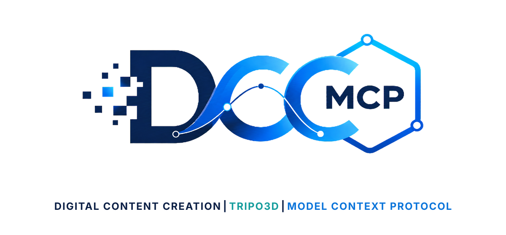
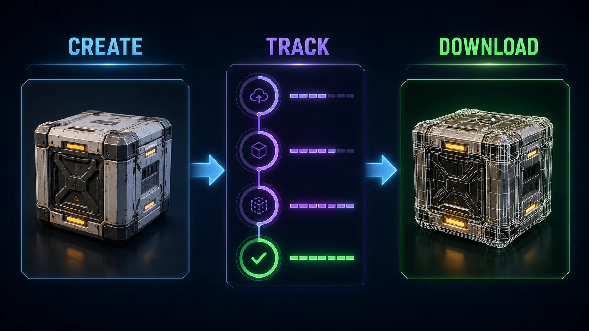

# DCC-MCP Tripo3D

<p align="center">
  
</p>

## Agent workflow

AI agents should use installed package skills through the shared gateway. IDE
users may continue to use the MCP endpoint.

### Install or update the CLI

`dcc-mcp-cli` is the preferred control path for every shell-capable agent. If
it is missing, ask the user before installing the latest official release:

```bash
# Linux/macOS
curl -fL https://raw.githubusercontent.com/dcc-mcp/dcc-mcp-core/main/scripts/install-cli.sh -o install-cli.sh
cat install-cli.sh
# After reviewing the file:
sh ./install-cli.sh
```

```powershell
# Windows PowerShell
Invoke-WebRequest https://raw.githubusercontent.com/dcc-mcp/dcc-mcp-core/main/scripts/install-cli.ps1 -OutFile .\install-cli.ps1
Get-Content -Raw .\install-cli.ps1
# After reviewing the file and subject to the current execution policy:
& .\install-cli.ps1
```

Keep an official build current through the release manifest:

```bash
dcc-mcp-cli update check
dcc-mcp-cli update apply --yes  # only after user confirmation
```

`update apply` downloads and stages the latest CLI for the next launch. It
does not update a running `dcc-mcp-server`; update that server in its own
environment.

Use `--require-gateway` for task calls so Gateway audit/stats records them.
This fails closed instead of falling back to direct MCP. Choose one stable
`<task-id>` and pass it to every tool call with `--agent-session-id`. This sets
`_meta.agent_context.session_id`; reuse the same ID in `stats --session-id`
after the task.

```bash
dcc-mcp-cli dcc-types
dcc-mcp-cli list
dcc-mcp-cli search --query "<task>" --dcc-type <host>
dcc-mcp-cli describe <tool-slug>
dcc-mcp-cli call <tool-slug> --require-gateway --agent-session-id "<task-id>" --json '{"key":"value"}'
```

If the package skill is not active, call
`dcc-mcp-cli load-skill <skill-name> --dcc-type <host>`. After the task,
query `dcc-mcp-cli stats --range "<task-window>" --session-id "<task-id>"` and pass only
bounded evidence to the `review_skill_improvement` prompt from
`dcc-mcp-skills-creator`.
Choose a supported `--range` covering the full task start-to-review window;
see `dcc-mcp-cli stats --help`.




Tripo 3D generation tools for DCC-MCP.

The scripts call the Tripo OpenAPI directly with Python stdlib. Set
`TRIPO_API_KEY` in the runtime environment before submitting jobs.

## Install

```bash
dcc-mcp-cli marketplace add dcc-mcp/dcc-ai-tripo3d
dcc-mcp-cli marketplace install dcc-ai-tripo3d
```

## Tools

- `create_tripo3d_task`
- `get_tripo3d_task`
- `download_tripo3d_task`
